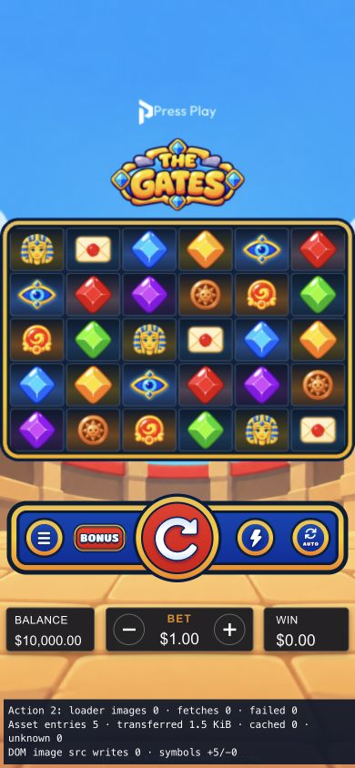

# Gates asset and performance cleanup

## Result

| Measure | Before | After |
| --- | ---: | ---: |
| Public static files | 284 | 134 |
| Public static bytes | 138,636,718 | 29,451,328 |
| Packaged site bytes | 34,621,343 | 28,901,052 |
| Runtime asset count | 127 | 122 |
| Main JavaScript bytes | 1,070,565 | 1,063,837 |
| Emitted CSS bytes, variant A | 119,338 | 73,565 |
| Emitted CSS bytes, variant B | 120,447 | 74,285 |
| Inline entry HTML bytes | 1,192,398 | 1,139,386 |

150 unused public files removed: **109,168,123 bytes**. Rebuilt authoring output and inventory updates also affect the final source total. Packaged site **16.5% smaller**; emitted CSS approximately **38% smaller**. Source-tree savings are not deployment savings: much legacy art was already excluded from uploads.

Dirty working tree preserved; no registry, dependency-version or wager-math changes. No commit or push.

## Sequential tasks
1. [x] Audit active code/asset graph, including atlas pages, dynamic families and authoring sources.
2. [x] Remove dead CSS references and unnecessary package-barrel imports.
3. [x] Remove proven-unused public assets; retain valid Wild/current motion dependencies and provenance.
4. [x] Optimize runtime-only code paths and validate authoring compatibility.
5. [x] Rebuild, verify assets/tests/types, measure before/after and record limitations.

## Retirement and retained assets

User explicitly approved retiring the obsolete pre-Figma authoring/test pipeline and removing its art. Removed old scene/temple/symbol prototypes, obsolete win/presentation rigs, shard exports, unused native exports, dead components and old HTML-renderer browser scripts. Current native motion generation and workbench rebuild successfully. Wild JSON, atlas and texture remain intact; its designer-dependent trumpet issue remains deferred, unchanged by cleanup.

222 dead CSS selectors removed conservatively; functional and attribute selectors excluded from automatic removal. Shared UI imports narrowed to actual modules. Production Spine actor no longer includes authoring-only Canvas2D drawing/cache code. Live animation sampling and GPU rendering remain intact.

Source cleanup is dry-run by default and never runs automatically during builds. Deletion requires explicit `--execute`. Current runtime closure, authoring sources, native inventories, provenance and licenses are protected. Current source audit proposes **zero further deletions**.

## Build-only lossless optimization

70 runtime PNGs checked; 62 compressed smaller. PNG bytes **28,616,069 → 25,880,410**, saving **2,735,659 bytes**. Only IDAT zlib encoding changes in generated build output. Every decompressed scanline and every non-IDAT chunk must remain byte-identical; CRCs verified. Retained source PNGs are untouched. No lossy conversion, resizing or texture-format change.

`build` now packages the dependency closure and performs this optimization. Packaging accepts only exact source bytes or verified PNG scanline/metadata equivalence; other mutations fail validation. No new dependency added. Shared inline/single-bundle hosting strategy retained.

## Validation

- TypeScript: pass.
- Active tests: **204/204 pass**. Obsolete pipeline-only tests retired alongside approved code retirement; five asset-cleanup/lossless-encoding tests added. This is not a claim that the old test suite remained unchanged.
- Native inventory verification: **51 PNGs + font**, geometry, byte counts, SHA-256, provenance and coverage pass.
- Native motion generator and authoring workbench rebuild: pass.
- Production build, packaged closure audit and source closure audit: pass.
- `git diff --check`: pass.
- Desktop and 390×844 portrait local preview checked; one Pixi canvas, 30 GPU tiles, no console errors. Rules/paytable checked. After warm-up, bet adjustment showed zero image-loader fetches or DOM image-source writes.
- No live RGS wagers performed. Preview checks do not establish live RGS acceptance or FPS improvement. Build retains pre-existing optional PUBLIC_* export/chunk advisory warnings.

## Evidence

- [Source deletion ledger and hashes](asset-source-cleanup.json)
- [Retired code ledger](retired-code-cleanup.json)
- [Dead CSS selector ledger](css-dead-selector-cleanup.json)
- [Build PNG encoding hashes](asset-encoding-cleanup.json)
- [Final measurements and validation](asset-cleanup-validation.json)
