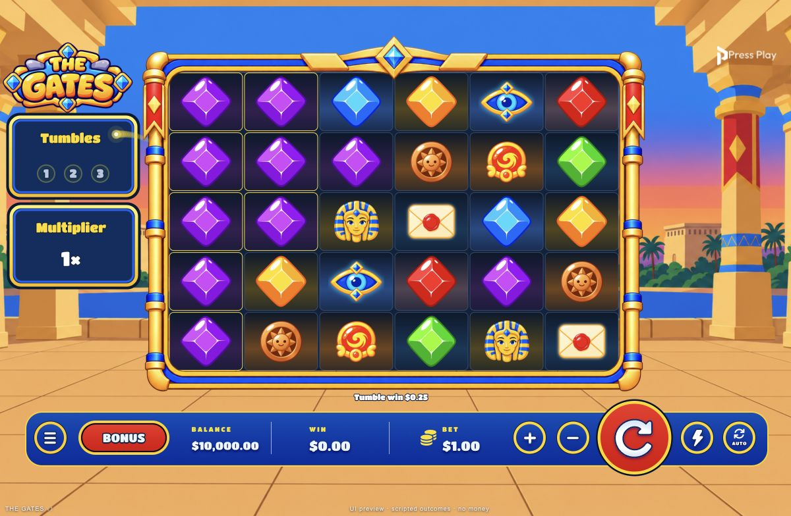
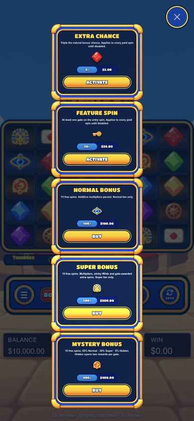
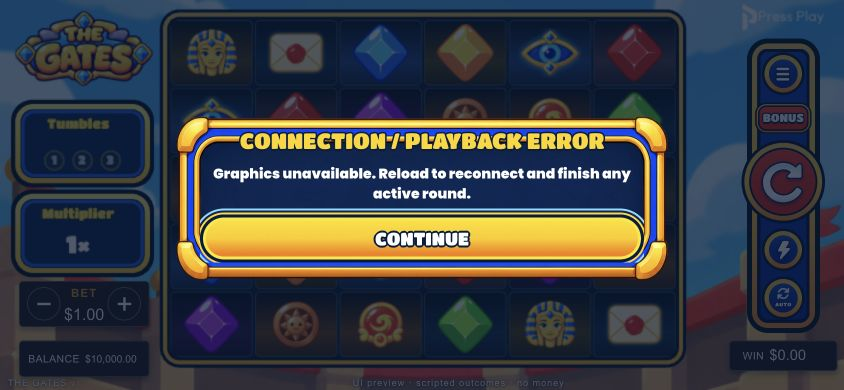

# Gates UI fixes — 2026-10-15

- [x] Landing: GPU button artwork removed; localized “Press to continue →” text retained with invisible accessible input target.
- [x] Portrait buy menu: fitted content centered; native card alpha bounds corrected without editing original PNG.
- [x] Tumble digits: full opacity, trimmed text bounds; centered 1/2/3. Portrait gains a compact counter below board, clear of logo.
- [x] Purchase/feature, unfinished-round and error confirmations use supplied frame, nine-sliced to preserve corners. No close X added.
- [x] Error: message + Continue; Continue calls page reload. Confirmed navigation using dev-only error fixture.
- [x] Pixi golden wisp from winning-cell centroid to newly incremented digit; matching fading trail, arrival ring and delayed visual illumination. 480ms flight + 120ms arrival; playback reserves this beat before subsequent gate events. Reduced motion skips travel. Single demand renderer, no extra timers/textures/tickers; active draw ends after arrival. Book values/math unchanged.

## Integration
`Game.svelte` forwards book progress/winning positions/reduced-motion preference → `ScenePanels.svelte` → retained `gpuPanels.ts` job. Existing engine owns rendering and teardown; flight uses frame delta clock. Modal and landing input remain accessible HTML; artwork follows existing Pixi/HTML boundary.

## Asset
`static/assets/the-gates/confirmation-frame.png` copied byte-identically from supplied `Gates Slot Game UI Frame 1.png` (841×470).
SHA-256: `c1f2400d5ba7810977631d791fdd9eccb0795d86e3af4f388ab452a34d3b7f81`.
Runtime dependency closure includes it; original is untouched. Other user attachments are visual references only.

## Checks
- 206/206 tests pass; two static assertions updated for requested framed markup/animated demand draw; two flight-math tests added.
- TypeScript, production build, packaging and lossless asset verification pass.
- Source asset audit: zero unused files. `git diff --check` passes.
- Local scripted preview only; no RGS wagers. Desktop 1200×784, portrait 390×844, landscape 844×390 inspected. Desktop numbers, wisp trail, landing text, portrait menu, purchase/resume/error frame inspected; error Continue navigation verified. Checked preview console errors: none.
- No FPS/low-end-device performance claim. Wisp bounded to 24 trail dots + three head circles + arrival ring; no shader/filter or new asset required. Draft translations require native review, like existing catalogs.

## Unfinished-round follow-up
Key removed. Play round retains existing RESUME_BET playback. Skip round calls `/wallet/end-round` once, rejects errors/missing or non-finite authoritative balance, then reloads to reauthenticate wallet/actor. Both actions disabled while request in flight. No local pending-round deletion on failure; error modal offers reload. Replay blocked; dev preview never calls RGS. Two settlement contract tests added; suite 208/208 pass. Desktop and 390×844 portrait action layout checked; live settlement not executed.
