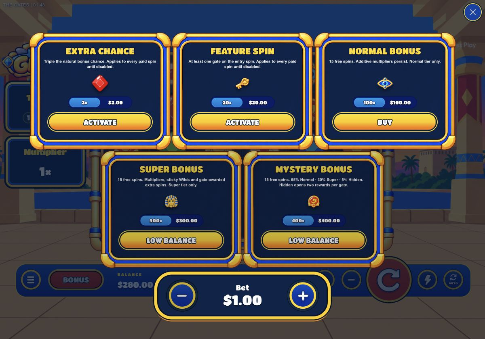
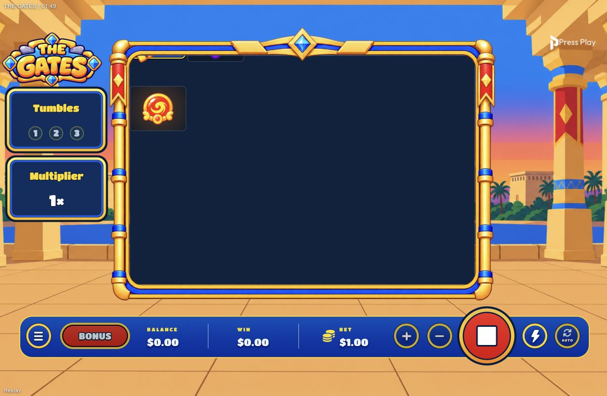
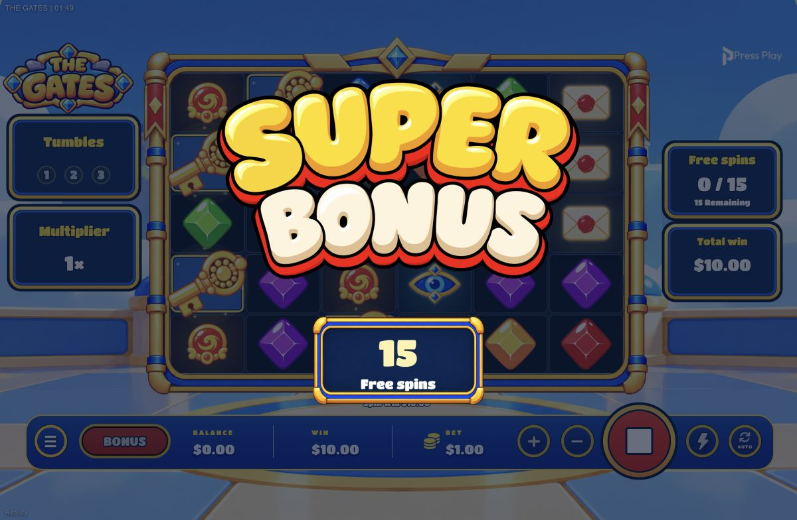

# Falling Keys / bonus-buy funds guards — 2026-10-16

## Fixed
### Key layering
- New poses start in their existing masked tile container.
- While entering, Keys stay masked until their own wave delay + travel duration completes. Then their pose is reparented above the board frame with equivalent board-local coordinates.
- Outgoing Keys stay masked throughout reel exit, even after travel completes. Stationary Keys and instant reduced-motion landings keep the over-frame treatment.
- Existing landing impact, scatter celebration, skip clock, masks and cleanup retained. No new canvas, mask, filter or frame loop; parent changes only at layer transitions.

### Bonus affordability
- Removed the blanket `mode === key` affordability exemption. Only active Chance/Feature toggles can be turned off without funds; purchases never bypass price.
- Card disabled state, Low balance caption, tooltip and selection handler use one availability policy. Handler rejects insufficient funds before closing the menu or setting confirmation selection.
- Confirmation independently rechecks current funds, protecting balance/bet changes after selection. Currency-independent comparison uses RGS 6-decimal wallet precision; exact funds allowed, one wallet unit short rejected. Invalid/non-finite values fail closed.
- Guards also apply to preview menus; RGS remains authoritative for actual transactions. No wager/book/payout changes.

## Verification
- **288/288 tests pass**; typecheck, production build, runtime packaging dry-run and `git diff --check` pass.
- Tests cover all 6×5 travel timings at Normal/Fast/Turbo, skip-tail boundaries, outgoing Keys, stationary Keys and reduced motion.
- Purchase tests cover every active-mode value at $280/$1, all paid-buy price boundaries, exact funds, one micro-unit short, wager changes and invalid amounts. Active toggle deactivation remains available without funds.
- Browser, approved localhost mock only:
  - $280 balance / $1 bet: Normal $100 enabled; Super $300 and Mystery $400 disabled with Low balance. Only eligible Normal opens confirmation; cancelled without purchase.
  - $0 / $1: Chance, Feature, Normal, Super and Mystery all disabled.
  - Real v8 Super replay 54: Keys clipped while dropping, then visible over the frame after landing; desktop and 390×844 portrait. No application console errors.
  - No wallet/play requests in either affordability session. No live wagers, uploads or commits.
- Physical-device performance/readability remains a human check.

