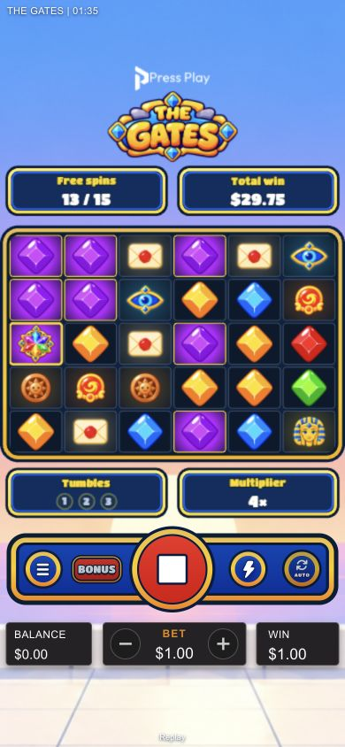
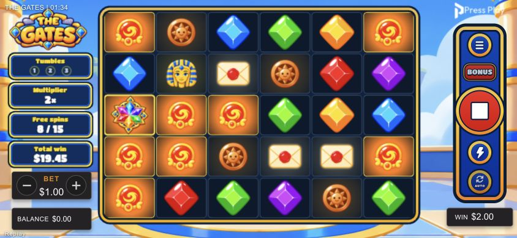

# Mobile stat-card layout — 2026-10-16

## Scope / clarification
Desktop frame treatment applies to the four stat cards only. The reel-grid frame remains unchanged. No changes to maths, RGS events, reward amounts, playback or input behavior.

## Complete
- Portrait Press Play and game logos raised. Logical stage gains header room without clipping its controls.
- Portrait Free spins / Total win sit side-by-side above the board. Both match Tumbles / Multiplier: 165×48 logical units, balanced 8-unit outer margins, centered title/value.
- All four cards use the same desktop navy/gold-gradient/blue rim renderer. Short-card rims scale proportionally; removed plain compact/mobile frame branch.
- Portrait Tumbles/Multiplier → round-control rail and rail → bet/balance/win controls both have an 18-unit layout gap. Browser measurement at 390×844: **19.5052px / 19.5px**, sub-pixel rounding only.
- Landscape bonus cards stack at y=84/130/176/222, each 130×40. Reduced Tumbles/Multiplier fonts; smaller elevated base-state cards too. Total-win card clears the bet selector at y=269. Logo fitted clear of the clock and first card.
- Mobile free-spin display uses only `N / M`; Remaining removed from both visible Pixi and mobile assistive copy. Desktop retains its Remaining line.
- Shared pure `panelLayout.ts` owns responsive card geometry and portrait control constants; HTML control CSS consumes those constants. Existing Pixi engine/lifecycle/reward targets retained.

## Verification
- **281/281** Node tests pass (four new layout tests; obsolete size assertions updated).
- TypeScript no-emit check, production Vite build, asset packaging dry-run and `git diff --check`: pass. Existing chunk-size advisory remains.
- Approved localhost mock, real v8 Super replay book 54; no live wagers. 390×844 portrait and 844×390 landscape inspected during bonus play and orientation changes. No application console errors.
- Pure fit/clearance tests also cover 320×568, 430×932 and 768×1024 portrait. Desktop card geometry asserted unchanged.
- No upload, commit or external transaction. Physical-device readability remains a human check.

