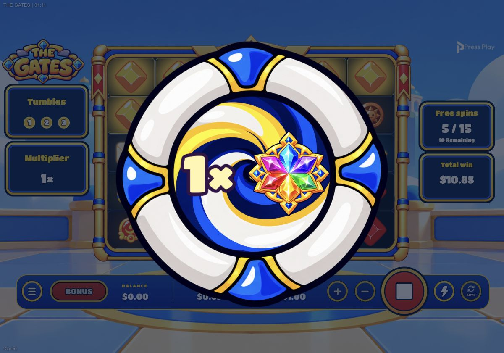
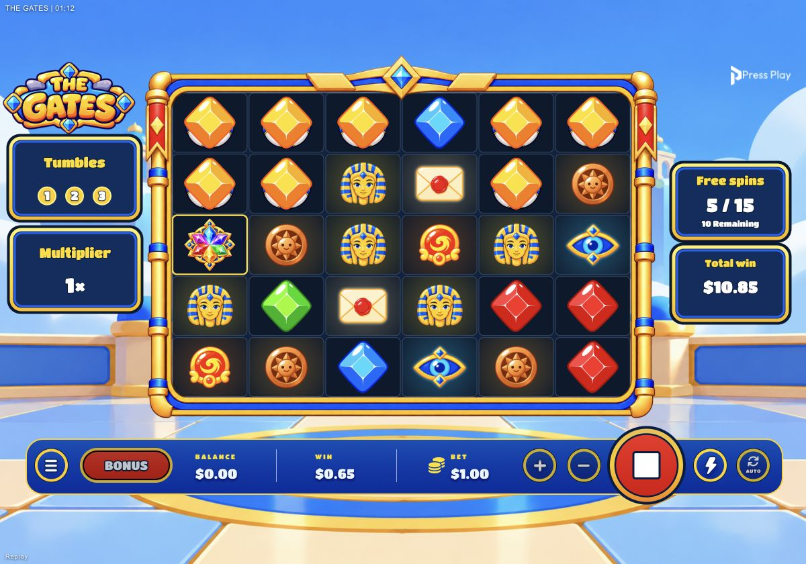
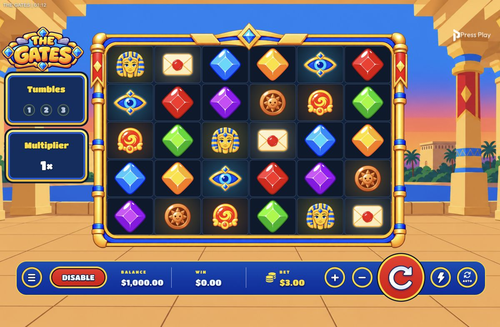
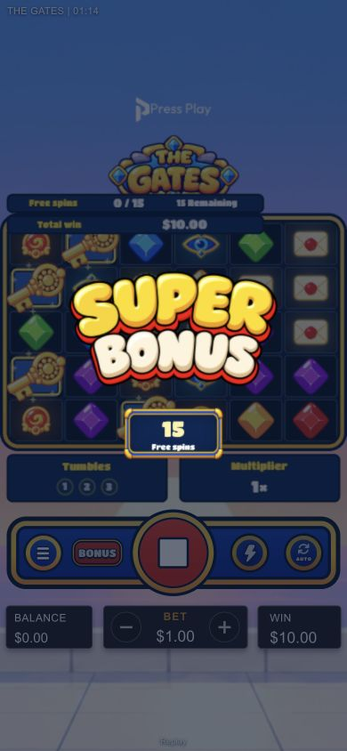

# Portal / Wild polish — 2026-10-16

## Completed
- [x] Mini portals and gate portals close by uniform shrink, never a horizontal/vertical pinch. Exit track shortened; the symbol suction and reward delivery clocks remain intact. Bonus-summary retraction also reaches the closing track before the next door cycle; no extra portal on return to base.
- [x] Non-control clicks during an active spin call the same `requestSkip()` as Space. Loading/landing, unfinished round, menus/modals, errors, bonus transitions and acknowledgement screens are excluded. Interactive descendants are excluded. Jurisdiction slam-stop restrictions remain enforced by the shared handler.
- [x] Sticky Wild reward reads `N× [Wild]`, count left; approximately 5px local gap rather than a separated icon/count.
- [x] New transparent rainbow-prism Wild, generated with image_gen using the native Eye as a style reference. Spine setup/idle/paying tracks; actual reward icons fly to authoritative Wild positions. Winning Wild pad takes its matched cluster's accent, not an invented payout or tint applied to other symbols. Premium-only idle halos remain unchanged.
- [x] Gate overlay unregisters when the post-gate `removing` phase begins. The full third-cluster removal wave runs before the reducer clears cells. Wild awards are delivered before removal; authoritative positions stay untouched.
- [x] Extra Chance HUD shows 2× wager cost in yellow. Base stake and win units unchanged.
- [x] Bonus-trigger Keys pulse/glow/sparkle from landing until bonus-entry acknowledgement. No blocking single-cycle celebration delay; shorter entry beat and dismissal guard. Entry spin still finishes all cascades/settlement before bonus intro. Reduced motion stays static and does not keep a standalone key-animation frame loop alive.
- [x] Keys alone render above the board frame in a separate unmasked canvas layer; other symbols remain inside the masked field. Key travel follows its own reel/tile position.

## Timeline / ownership
| Event | Ordered presentation | Ownership / exit |
| --- | --- | --- |
| Paying cluster | Selection → optional third-cascade gate/reward → full mini-portal removal → reducer clears → next reveal | Book events unchanged; wave barrier owns completion |
| Mini portal close | Full opening until authored 0.87s → uniform scale 0.35 at 0.90s → 0.001 at 0.93s | Canonical 1s track; wave speed still Normal/Fast/Turbo |
| Gate portal close | Hold to authored 1.85s → uniform 0.48 at 1.91s → 0.001 at 1.98s | Live gate clock maps track onto existing reward outro; delivery barrier unchanged |
| Bonus trigger | Land Keys → looping celebration while entry spin settles → doors/bonus intro → user acknowledgement → first free spin | Clear on acknowledgement, reset, cancel or finally; never auto-enters |
| Bonus exit | User acknowledgement → summary retracts → first portal shrinks closed → doors close/open → base | Second door cycle hides portal throughout |
| Tap / Space | Eligible active spin → shared slam-stop | UI-only; cannot cancel a result or initiate another wager |

Svelte owns state/DOM hosts. Existing shared Pixi engine owns draw/layout/unregister/destroy; no new canvas, ticker, filter or RAF loop. Only one additional retained Key container. Asset hash/provenance lives with the new Wild rig; obsolete Wild JSON/atlas/PNG retired with an independent hash ledger in `reports/rainbow-wild-retirement-20261016.json`.

## Verification
- TypeScript `tsc --noEmit`: pass.
- Full Node suite: **277/277 pass**, no skipped/cancelled tests.
- Production Vite build: pass. Existing large-chunk advisory remains; no new build errors.
- Runtime packaging dry-run: 174 assets, all dependencies resolve; source cleanup test reports zero unused public assets.
- `git diff --check`: pass.
- Browser: approved localhost mock RGS, real v8 Super book 54; no live wagers. Desktop and 390×844 portrait.
  - Count-first rainbow Wild reward captured, then actual Wild cell shown after arrival.
  - After first Sticky Wild gate: `Tumbles 3/3`, `Free spins 5/15`, board `data-phase=removing`, gate `aria-hidden=true`; third-cluster mini portals visible.
  - Extra Chance: base $1.50 → displayed cost $3.00, computed text color `rgb(255, 220, 18)`; mock debit $3.00. Screen tap exercised during playback.
  - Keys overlap frame on desktop and portrait; bonus-entry remains waiting for user interaction.
  - Final-build portrait reload/replay smoke: no application console errors.
- No math books/paytables/weights changed. No upload or commit.

## Evidence

## Residual validation
Physical-device/touch performance and subjective approval of generated Wild artwork remain human checks. Browser checks used a local mock, not live RGS. Reduced-motion behavior, all portal palettes and bonus-exit close sequencing also covered by regression tests.
