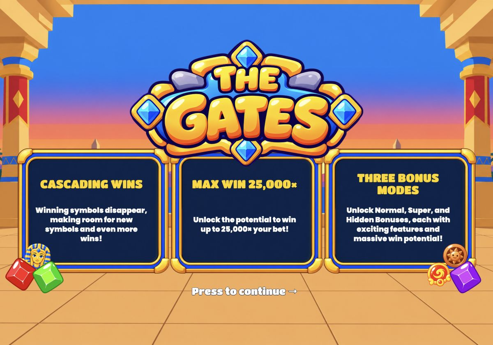
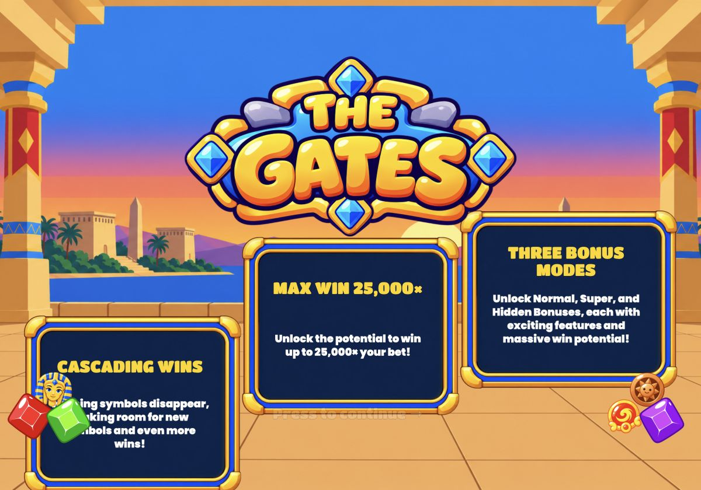
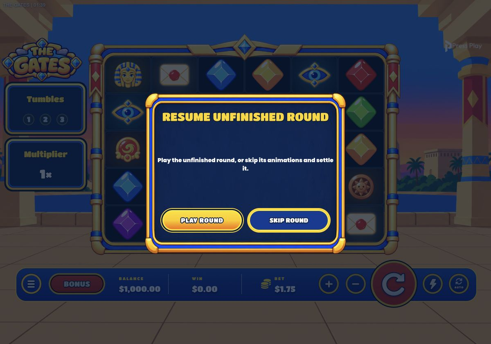
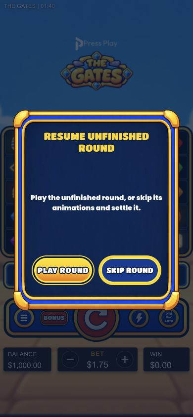

# Unfinished-round startup order — 2026-10-16

Fixed flow: **loader → landing → user Continue/tap → landing exit + board/HUD entrance → unfinished-round modal**.

- Pending server round no longer bypasses landing asset readiness or unhides the game before entry.
- Resume modal requires `pending && entered && !entryLeavingAt`; the existing entry-completion timer releases it after 1250ms, or 140ms with reduced motion.
- Pending state still locks new wagers and bet changes throughout landing/entry. The unfinished result is neither replayed nor settled until the player chooses Play or Skip.
- After entry, board/HUD remain visible beneath the modal. Existing resume and end-round paths unchanged.

Verification:
- **282/282 tests pass**; typecheck, production build, packaging dry-run and diff whitespace check pass.
- Approved localhost mock with a real v8 unfinished round. Desktop and 390×844 portrait: dialog count 0 on landing; 0 while `entry-leaving` is present; modal visible only after that class clears.
- Desktop Skip: exactly one authenticate and one end-round request; no new play or reload; final mock balance $1,000.35.
- Portrait Play: recorded round plays and settles; Spin re-enabled; final mock balance $1,000.35 and win $0.35. No application console errors.
- No live wagers, uploads or commits. Reduced-motion order covered by the shared entry timeline and regression assertions, not OS-setting changes.

